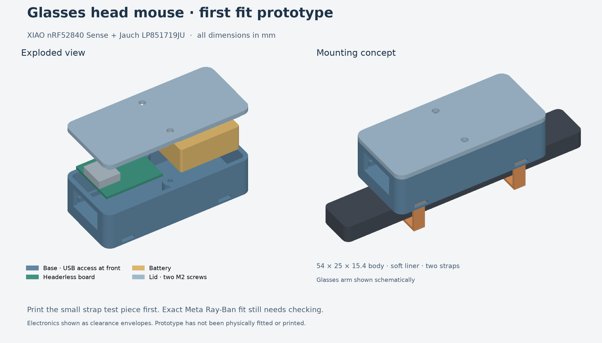

# Glasses enclosure prototype

This prototype holds a headerless Seeed XIAO nRF52840 Sense and a Jauch LP851719JU battery. Two straps attach its flat padded back to a glasses arm. The mount is adjustable by strap length and positioning.

The glasses arm in the preview is schematic. Fit has not been verified for a specific glasses frame; confirm the arm and battery dimensions before printing. Print the strap test piece first and check the full enclosure footprint on your own glasses.



## Print files

| File | Purpose |
| --- | --- |
| `base.stl` | Main body, board support rails, screw towers and enclosed strap tunnels |
| `lid.stl` | Removable locating lid, already oriented with its broad outer face on the bed |
| `strap_test.stl` | Small test piece with the same tunnel and back surface as the enclosure |
| `build_enclosure.py` | Editable CAD generator and mesh validation |
| `requirements-cad.txt` | Dependencies for regenerating the files |

All STL coordinates are millimetres. Keep the slicer scale at 100%.

## Dimensions and component fit

| Item | Size or allowance |
| --- | --- |
| Assembled printed body | 54 × 25 × 15.4 mm, excluding screw heads and padding |
| Main wall / lid face | 1.6 / 1.6 mm |
| Strap tunnels | 4.8 mm wide × 1.4 mm high, crossing the full 25 mm width |
| Strap centers | 36 mm apart |
| Lid clearance | 0.25 mm per side |
| Screw holes | Lid 2.3 mm clearance, base 1.7 mm pilots |
| Board | 21 × 17.8 mm, USB facing the short front end |
| Board underside above floor | 2.1 mm nominal, including thin mounting tape |
| Battery envelope | 22 × 18 × 9.2 mm, with 0.5 mm below and above |
| Strap test piece | 18 × 25 × 3.6 mm |

The battery allowance uses the manufacturer's maximum thickness after cycling. The preview represents the electronics with simple clearance blocks. The board's underside components, solder joints, cable routing and USB plug must be checked with your actual parts.

The board and battery sit in tandem along the arm. The two screw towers occupy the gap between them. Route the battery leads through the corridor between the towers, with the battery's wire exit facing the board. Coil any extra wire loosely in the remaining board bay.

The design uses the board footprint and USB position from Seeed's mechanical resources, with an oversized 14 × 7 mm USB opening. The current CAD checks use a simplified board envelope, rather than importing the STEP assembly. Use a board supplied without pin headers.

- [Seeed board specifications and mechanical files](https://wiki.seeedstudio.com/XIAO_BLE/#resources)
- [Jauch battery dimensions and specifications](https://www.jauch.com/downloadfile/677e33c97ce2259996c3e0a625aa7071d/matd_237924_20200507_180mah_-_lp851719ju_1s1p_2_wire_50mm.pdf)

## Additional parts

- Two M2 × 6 mm pan-head screws suitable for forming threads in printed plastic. Start the threads with the enclosure empty. Adjust the pilot diameter in the source if needed for your screws and printer.
- Two narrow reusable straps up to 4 mm wide and 1 mm thick. Slim 2.5 mm nylon cable ties also fit. Place closures on the outside.
- Approximately 1 mm soft silicone or EVA liner between the case and the glasses.
- Thin insulating double-sided tape to locate the PCB on its two edge rails.
- Up to 0.5 mm soft battery mounting tape.

## Print and assemble

1. Print `strap_test.stl`, in its supplied orientation. Try the straps through the tunnel. Add a soft liner and place the piece against the outside of the glasses arm. Tighten just enough to stop it sliding. Confirm that it leaves the buttons, speakers, hinge and charging contacts accessible.
2. Mark a 54 × 25 mm rectangle on card and check the full footprint at the intended position. Check clearance to your head and ear, and make sure the glasses can still fold.
3. Print the base and lid in PETG as a starting choice. Use a 0.4 mm nozzle, 0.2 mm layers, three perimeters and 20% infill. Print in the supplied orientations. The tunnel roofs bridge 4.8 mm, and the USB opening bridges 14 mm. Inspect both in the slicer and tune bridging for your printer. Supports should ordinarily be unnecessary.
4. Remove any strings from the strap tunnels and USB opening. Start both screw threads in the empty base. Place the lid and check that it sits flat without force.
5. Fit the PCB first with USB facing the front. Check that a cable plugs in fully and that the underside components and solder joints clear the floor. Secure only the narrow board edges on the rails using thin insulating tape. The board needs a rigid mounting for reliable IMU readings.
6. Fit the battery with its wire exit toward the board, and attach it with thin foam tape. Lay the leads in the corridor between the screw towers. Check that the lid closes without pressing on the cell or trapping a wire.
7. Fit the lid with the two M2 × 6 mm screws. Strap the padded back to the outer face of the glasses arm. Check stability with gentle head turns, then recalibrate the head mouse in this mounted orientation.

A battery that has expanded beyond its specified envelope requires replacement. The case should close freely around the specified cell. Charge the assembled prototype off the glasses while checking its temperature.

## Validation and remaining checks

The generator checks that each exported part is a single closed, consistently oriented solid. It reloads the STL files to verify dimensions, checks base-to-lid interference, and checks the simplified board and maximum battery envelopes against the case. All three parts also sliced successfully in PrusaSlicer at 0.2 mm layers with three perimeters and 20% infill.

These are digital checks. No physical print, fit on the Meta Ray-Bans, USB plug fit, strap grip or wearer comfort has been verified. Printer tolerances, board soldering and the exact battery pack may require revisions.

## Regenerate or adjust

Use a separate environment for CAD generation.

```sh
python3 -m venv .venv-cad
.venv-cad/bin/python -m pip install -r enclosure/requirements-cad.txt
.venv-cad/bin/python enclosure/build_enclosure.py
```

The script writes the three STL files and preview beside itself. Mounting parameters are near the top of the script, including tunnel size and spacing, lid clearance and screw pilot diameter. Board and battery placements are defined explicitly. A change to battery size or enclosure length also needs the placements and clearance envelopes updated together.
